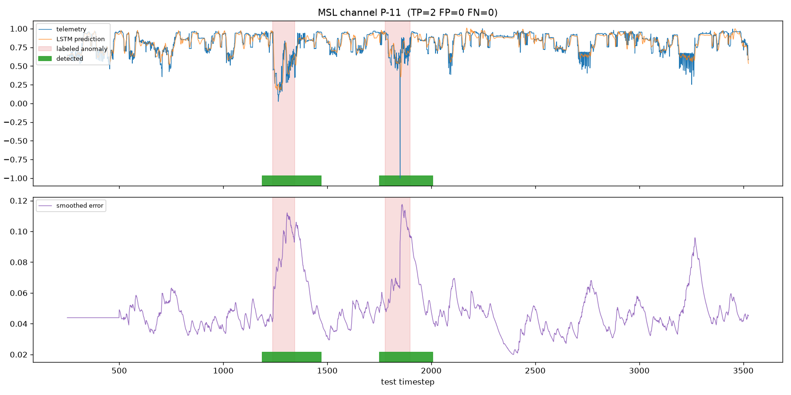
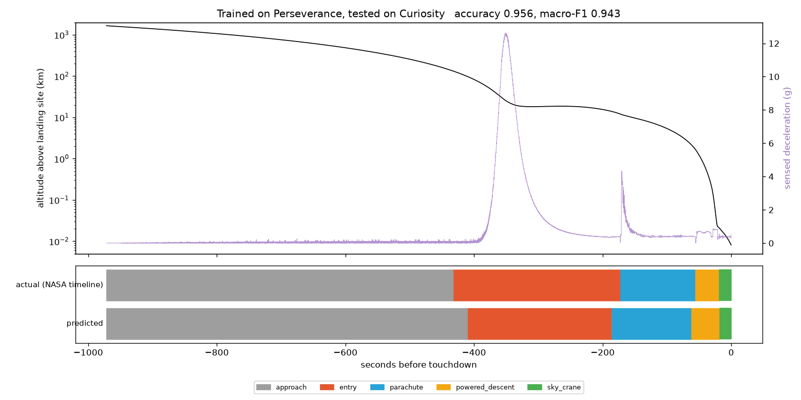
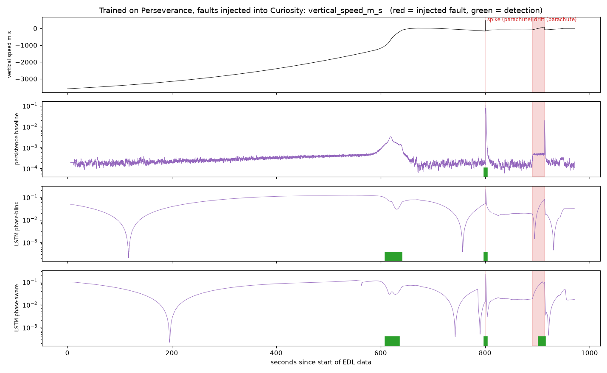

# Demo AI Prediction Model Space

**Phase-aware spacecraft anomaly detection** — an AI system that learns how a spacecraft
normally behaves, flags abnormal changes, and understands which mission phase it is in:
Earth → Mars cruise, or the stages of entry, descent & landing.

```
Mars 2020 trajectory ──► Phase classifier ──┐
   (+ injected faults)                      ├──► Phase-aware anomaly engine ──► FastAPI ──► Flutter app
MSL / SMAP telemetry ───────────────────────┘        (LSTM + dynamic threshold)
```

| Module | Data | Status |
|---|---|---|
| **1. Anomaly engine** | NASA SMAP & MSL telemetry with expert-labeled anomalies | ✅ implemented, validated |
| **2. Mission phase classifier** | Perseverance + Curiosity reconstructed trajectories from NASA SPICE | ✅ implemented, cross-mission tested |
| **3. Fault injection + phase-aware detection** | Six sensor-fault types injected into both landings | ✅ implemented, cross-mission tested |
| 4. API + mobile app | FastAPI backend, Flutter dashboard | planned |

---

## Module 1 — Anomaly engine

Re-implementation in modern PyTorch of the method from
Hundman et al., *Detecting Spacecraft Anomalies Using LSTMs and Nonparametric Dynamic
Thresholding*, KDD 2018 ([paper](https://arxiv.org/abs/1802.04431),
[reference code](https://github.com/khundman/telemanom)).

**How it works**

1. **Learn normal behaviour** — one LSTM per telemetry channel (2 layers × 80 units) reads the
   last 250 timesteps (telemetry value + 54 one-hot command flags) and predicts the next value.
2. **Prediction error** — where the spacecraft does something the model did not expect, the
   error grows. Errors are smoothed with an exponentially weighted moving average.
3. **Dynamic threshold** — no fixed cut-off. In a sliding window of recent errors the engine
   searches thresholds `mean + z·std` (z = 2.5 … 12) and picks the one that best separates a few
   compact anomalous regions from the rest. It also checks for unexpected *drops*.
4. **Pruning** — weak detections whose peak error is < 13 % above the next-highest are dropped,
   which removes most false alarms.

**Evaluation** (as in the paper): a labeled anomaly counts as found (TP) if any detected
sequence overlaps it; a detection overlapping no labeled anomaly is a false positive.

### Validation against the original implementation

The Kaggle archive ships the original 2018 LSTM predictions and run log. Feeding those
predictions into this repo's thresholding code (`scripts/validate_threshold.py`):

| | Channels identical to original | Precision | Recall | F0.5 |
|---|---|---|---|---|
| MSL | **27 / 27** | 0.962 | 0.694 | 0.893 |
| SMAP | 50 / 55 ¹ | 0.838 | 0.899 | 0.849 |

¹ The remaining SMAP differences come from the label file: the Kaggle labels were revised after
the 2018 run, so a few channels are being scored against different ground truth.

### Results — our own trained LSTMs on MSL

Full pipeline (training from scratch on a MacBook Air M3 CPU, ~27 min, single seed):

| | TP | FP | FN | Precision | Recall | F1 | F0.5 |
|---|---|---|---|---|---|---|---|
| **This repo (PyTorch, 1 run)** | 20 | 3 | 16 | **0.870** | 0.556 | 0.678 | 0.781 |
| Original 2018 Telemanom LSTMs ² | 25 | 1 | 11 | 0.962 | 0.694 | 0.806 | 0.893 |

² The original models' saved predictions, scored with the same code and the current labels.

19 of 27 channels give exactly the same result as the original. The 8 that differ
(M-2, M-3, P-15, C-2, F-4, D-15, D-16, F-8) differ in both directions. For example, we catch
M-2, which the original missed. This is expected run-to-run variance of per-channel LSTMs: the
original was trained once with Keras, and the random initialisation alone moves single channels.
Next steps to close the gap: train several seeds per channel and average the predictions.



More plots: [M-6](results/msl/plots/M-6.png) · [F-7](results/msl/plots/F-7.png) · per-channel
numbers in [`results/msl/channel_results.csv`](results/msl/channel_results.csv).

---

## Module 2 — Mission phase classifier (Mars entry, descent & landing)

Knows *where in the mission* the spacecraft is, so the anomaly engine can judge readings
against what is normal for that phase (10 g of braking is normal during entry, an emergency in cruise).

### Data: two real Mars landings from NASA SPICE

`scripts/build_mars_dataset.py` downloads NASA NAIF kernels and samples them into CSVs:

| File | Rows | What |
|---|---|---|
| `m2020_edl.csv` | 9,588 | Perseverance landing, 18 Feb 2021, 10 Hz, labeled phases |
| `msl_edl.csv` | 9,716 | Curiosity landing, 6 Aug 2012, 10 Hz, labeled phases |
| `m2020_cruise.csv` | 29,279 | Perseverance Earth → Mars cruise, every 10 min (Sun/Earth/Mars-relative) |
| `events.csv` | 12 | As-flown event times used for the labels |

The landing trajectories are NASA's final reconstructions from each rover's **descent IMU**,
integrated back from the known touchdown point. Columns include altitude above the landing
site, Mars-relative speed, vertical speed, flight-path angle and **sensed acceleration**
(non-gravitational: drag, parachute, rocket thrust). The cruise file starts ~1 h after launch,
so launch itself is not covered.

**Phases** — the same five for both rovers:

| Phase | Starts at | Perseverance alt / speed | Curiosity alt / speed |
|---|---|---|---|
| approach | start of EDL data (cruise stage already gone) | 1,422 km | 1,655 km |
| entry | entry interface (radius 3,522.2 km) | 130 km / 5,333 m/s | 131 km / 5,845 m/s |
| parachute | parachute deploy | 12.6 km / 434 m/s | 12.1 km / 406 m/s |
| powered_descent | backshell separation | 2.16 km / 81 m/s | 1.67 km / 79 m/s |
| sky_crane | rover separation | 20 m | 21 m |

**Where the event times come from** (details and arithmetic in
[`events.py`](src/spacecraft_ai/phases/events.py)):
* Perseverance — event table in Karlgaard et al., *MEDLI2 Trajectory, Aerodynamics and
  Atmosphere Reconstruction* ([NTRS 20210024320](https://ntrs.nasa.gov/api/citations/20210024320/downloads/MEADSreconstruction.pdf)),
  anchored on the official touchdown time in the NAIF kernel. Check: the trajectory sits at the
  paper's entry-interface radius (3,522.2 km) to within 10 m at the paper's entry time.
* Curiosity — NASA's as-flown landing timeline; backshell separation (missing from that
  table) computed from the as-flown flight-computer mode durations in Way et al., AAS 13-420
  ([NTRS 20130011617](https://ntrs.nasa.gov/api/citations/20130011617/downloads/20130011617.pdf)).
  Check: the same mode table reproduces NASA's heat-shield, rover-separation and touchdown
  times to within 0.06 s.

### Model

Gradient-boosted trees on 9 physical features (altitude, speed, vertical speed, flight-path
angle, sensed acceleration and 2-second *past-only* rolling statistics) — nothing a clock or a
mission name could leak, and everything available in real time. A forward-only decoder
(phases never go backwards) is applied on top as a safety net.

### Results — trained on one rover, tested on the *other*

A random train/test split on one trajectory would be meaningless (neighbouring samples are
nearly identical), so the test is a different spacecraft and a different landing:

| Train → Test | Accuracy | Macro F1 | Phase-start timing error (entry / parachute / powered descent / sky crane) |
|---|---|---|---|
| Perseverance → **Curiosity** | **0.956** | 0.943 | +22.1 s / −13.4 s / −6.2 s / +0.8 s |
| Curiosity → **Perseverance** | **0.984** | 0.963 | −0.6 s / +8.3 s / +6.1 s / −0.7 s |



The model produces exactly four clean phase changes on both landings, with no flickering. The
largest error, calling Curiosity's *entry* 22 s late, is physical, not random: entry interface
is a geometric marker at ~125 km, and drag only becomes noticeable ~20 s later. With only two
landings (both of the same sky-crane design) this shows the idea transfers; it is not a
general guarantee for other spacecraft.

---

## Module 3 — Fault injection and phase-aware anomaly detection

NASA's landing reconstructions are clean, so there is nothing to detect. To *measure* the
anomaly engine on a landing, we corrupt copies of the data with sensor faults whose type,
position and size are recorded. Those records are the labels.

**Six fault types** ([`inject.py`](src/spacecraft_ai/faults/inject.py)), injected into the IMU
**sensed acceleration** or the **vertical speed**. Each is placed in a randomly chosen phase, and
sized as a fraction of the signal's range (as in the NASA telemetry of module 1):

| Type | What it simulates | Size | Duration |
|---|---|---|---|
| spike | transient glitch / bit flip | 10–30 % of range | 0.1–0.5 s |
| bias | sudden calibration jump | 3–8 % | 3–20 s |
| drift | slowly growing sensor error | ramps to 5–12 % | 10–30 s |
| stuck | output frozen at last value | — | 3–15 s |
| noise | burst of vibration / interference | σ 2–5 % | 3–15 s |
| dropout | signal reads zero | — | 1–5 s |

Realistic background noise (IMU 0.05 m/s², vertical speed 0.2 m/s) is added to all data.

**Protocol** ([`experiment.py`](src/spacecraft_ai/faults/experiment.py)) — train on the
*clean* landing of one rover, inject faults into the *other* rover's landing (40 scenarios
× 2 faults × 2 signals × 2 directions = **320 faults per detector**). Three detectors share
the module-1 dynamic threshold:

* **persistence baseline:** predicts "the next reading equals the last one".
* **LSTM phase-blind:** the module-1 forecaster, inputs = the sensor signals.
* **LSTM phase-aware:** the same, plus the current phase as one-hot inputs (like the command
  flags in the MSL telemetry). The phase is **never taken from the labels**: it is what the
  module-2 classifier predicts from the faulty data at that moment.

### Results

| Detector | Faults caught | False alarms (faulty runs) | False alarms on clean landings | Precision | F1 |
|---|---|---|---|---|---|
| persistence baseline | 115 / 320 (36 %) | 76 | 2 | 0.60 | 0.45 |
| LSTM phase-blind | 143 / 320 (45 %) | 265 | 7 | 0.35 | 0.39 |
| **LSTM phase-aware** | 141 / 320 (44 %) | **187** | **5** | 0.43 | 0.44 |

Fraction of faults caught, by type:

| | spike | bias | drift | stuck | noise | dropout |
|---|---|---|---|---|---|---|
| persistence baseline | **0.93** | 0.02 | 0.04 | 0.04 | **0.94** | 0.19 |
| LSTM phase-blind | 0.74 | 0.56 | **0.53** | 0.08 | 0.53 | 0.23 |
| LSTM phase-aware | 0.67 | **0.60** | 0.51 | 0.08 | 0.55 | 0.23 |

**What this shows**

1. **Knowing the phase cuts false alarms by ~30 %** (265 → 187) while catching the same
   number of faults. On clean landings the phase-blind model mistakes normal entry braking for
   a fault 6 times; the phase-aware one 3 times. This is the effect the whole design is built on.
   It comes from one training run per model on two landings, so treat it as an encouraging
   result, not a precise figure.
2. **The two detector families are complementary.** Prediction models catch slow faults
   (bias, drift) that the "same as last reading" baseline almost never sees, and the baseline is
   far better at sudden spikes and noise bursts. Flagging a fault when *either* the baseline or the
   phase-aware LSTM fires catches **55 %** of all faults (vs. 44 % / 36 % alone).
3. **Hard cases.** A *stuck* sensor (8 %) or a *dropout* to zero (23 %) is nearly invisible
   when the true value is already flat or near zero: in the sky-crane hover, vertical speed is
   −0.75 m/s and acceleration equals gravity. The LSTMs also lose accuracy when Curiosity flies
   outside the range seen on Perseverance (it entered ~500 m/s faster), which is visible as a
   higher error floor during approach.



Next steps: combine the baseline and LSTM detectors properly (and measure the combined false
alarms), train several seeds, and add physics cross-checks between signals (e.g. altitude rate
vs. vertical speed) to catch stuck and dropout faults.

---

## Quick start

```bash
python3.11 -m venv .venv
source .venv/bin/activate
pip install -r requirements.txt

python scripts/download_data.py                    # NASA SMAP/MSL from Kaggle (~86 MB)
python scripts/validate_threshold.py MSL           # check thresholding vs. original
python scripts/run_anomaly_engine.py --spacecraft MSL
python scripts/plot_channel.py M-6                 # results/msl/plots/M-6.png

python scripts/build_mars_dataset.py               # NASA SPICE kernels (~45 MB) -> Mars CSVs
python scripts/train_phase_classifier.py           # results/phases/
python scripts/run_fault_injection.py              # results/faults/ (~45 min on a laptop CPU)
```

## Project layout

```
src/spacecraft_ai/
  anomaly/          # module 1
    config.py       #   hyperparameters (defaults = original paper)
    data.py         #   load channels, build windows
    model.py        #   PyTorch LSTM forecaster + training w/ early stopping
    threshold.py    #   error smoothing, dynamic threshold, pruning
    metrics.py      #   sequence-level precision / recall / F-scores
    pipeline.py     #   train → predict → detect → evaluate, per channel
  phases/           # module 2
    events.py       #   as-flown EDL event times for both rovers, with sources
    extract.py      #   NASA SPICE kernels -> cruise / EDL tables
    classifier.py   #   features, gradient-boosted classifier, forward-only decoding
  faults/           # module 3
    inject.py       #   six documented sensor-fault types
    experiment.py   #   cross-mission phase-aware vs phase-blind vs baseline comparison
scripts/            # command-line entry points
results/            # metrics, per-channel results, plots, trained models (.pt)
data/               # downloaded data (git-ignored)
```

## Data

* **SMAP / MSL telemetry** — [Kaggle](https://www.kaggle.com/datasets/patrickfleith/nasa-anomaly-detection-dataset-smap-msl),
  originally released by NASA JPL with Hundman et al. 2018. MSL = Curiosity rover (27 channels),
  SMAP = Soil Moisture Active Passive satellite (55 channels). Values are scaled and channel
  names anonymized; anomalies were labeled by mission experts from incident reports.
* **Mars 2020 and MSL trajectories** (module 2) — reconstructed cruise and EDL ephemerides from
  NASA NAIF SPICE ([Mars 2020](https://naif.jpl.nasa.gov/pub/naif/pds/pds4/mars2020/mars2020_spice/),
  [MSL](https://naif.jpl.nasa.gov/pub/naif/pds/data/msl-m-spice-6-v1.0/mslsp_1000/)).
  These are navigation reconstructions, not raw sensor data, and contain no labeled anomalies —
  which is why module 3 injects documented synthetic faults for evaluation.
  Faults are synthetic: they show *how well the engine would catch* these failure modes, not
  that these faults happened on the real missions.

The two datasets come from different spacecraft and are never merged row-by-row; they share the
*anomaly engine* and the *app*, not the data.
